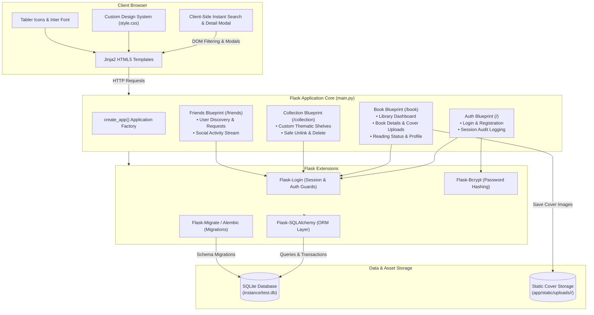
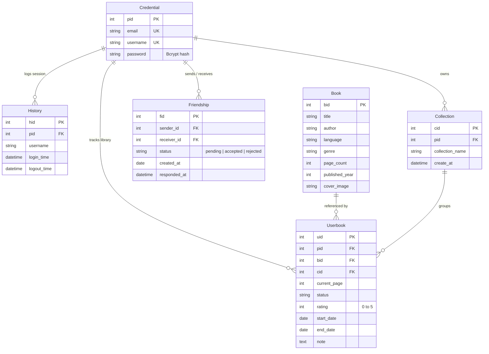

# 📚 My Personal Book Vault

<div align="center">


**A modern, self-hosted personal library manager, reading progress tracker, and social bookshelf built with Flask and SQLAlchemy.**

[Features](#-key-features) • [Architecture](#%EF%B8%8F-system-architecture) • [Getting Started](#-getting-started) • [API Routes](#-api-routes-reference) • [Workflow](#-example-workflow)

</div>

---

## 📑 Table of Contents

- [Overview](#-overview)
- [The Problem](#-the-problem)
- [Our Solution](#-our-solution)
- [Key Features](#-key-features)
- [How It Works](#-how-it-works)
- [UI & Screenshots](#-ui--design)
- [System Architecture](#%EF%B8%8F-system-architecture)
  - [Component Architecture](#component-architecture)
  - [Database Schema (Entity-Relationship)](#database-schema-entity-relationship)
- [Tech Stack](#-tech-stack)
- [Project Structure](#-project-structure)
- [Getting Started](#-getting-started)
  - [Prerequisites](#prerequisites)
  - [Step 1: Clone the Repository](#step-1-clone-the-repository)
  - [Step 2: Environment Configuration](#step-2-environment-configuration)
  - [Step 3: Setup Virtual Environment & Dependencies](#step-3-setup-virtual-environment--dependencies)
  - [Step 4: Database Migrations](#step-4-database-migrations)
  - [Step 5: Run the Application](#step-5-run-the-application)
- [Environment Variables](#-environment-variables)
- [API Routes Reference](#-api-routes-reference)
- [Example Workflow](#-example-workflow)
- [Testing & Verification](#-testing--verification)
- [Docker Deployment](#-docker-deployment)
- [Limitations & Future Roadmap](#-limitations--future-roadmap)
- [Contributing](#-contributing)
- [Author & Acknowledgements](#-author--acknowledgements)
- [License](#-license)

---

## 📖 Overview

**My Personal Book Vault** is a lightweight, responsive web application designed for avid readers, students, and book clubs who want complete ownership over their reading records. It combines catalog management, reading status metrics (page-by-page progress, completion dates, star ratings, and personal notes), custom organizational shelves, and a built-in friend network with a live reading activity feed.

Built on Python, Flask, and SQLite, Book Vault is fully self-hostable, fast, and free of third-party tracking, advertisements, and commercial bloat.

---

## 🚨 The Problem

Modern readers face recurring challenges with commercial book tracking platforms:

* **Commercial Bloat & Algorithmic Clutter:** Mainstream platforms prioritize book selling, sponsored recommendations, and cluttered community feeds over personal reading utility.
* **Privacy & Data Ownership Concerns:** Reading logs, personal book notes, and private reading speed metrics are stored on external commercial cloud servers without straightforward offline self-hosting options.
* **Rigid Shelving Systems:** Many reading trackers restrict users to rigid predefined shelves (`Want to Read`, `Currently Reading`, `Read`) and make custom thematic organization cumbersome.
* **Distracting Social Feeds:** Social features in popular reading apps often drown out what your actual friends are reading beneath influencer reviews and promotional content.

---

## 💡 Our Solution

**My Personal Book Vault** provides a clean, focused, and self-hosted alternative:

1. **Self-Hosted Data Ownership:** Your book database, reading logs, and login histories live in your own SQLite database instance with zero external telemetry.
2. **Granular Reading Progress:** Track your progress page-by-page with automatic percentage calculations, visual progress bars, start/finish timestamps, and 0–5 star ratings.
3. **Flexible Thematic Collections:** Create custom user-specific collections (e.g., *“Sci-Fi Classics”*, *“Summer 2026”*, *“Engineering Handbooks”*). When a collection is deleted, books are safely unlinked rather than permanently purged.
4. **Focused Social Circle & Activity Stream:** Connect directly with friends through peer-to-peer friend requests and view a dedicated chronological feed of what your friends are reading and finishing.
5. **Fast & Responsive Dashboard:** Real-time client-side search filtering across titles, authors, and collections, paired with click-to-preview book modals for an instant, desktop-grade experience.

---

## 🌟 Key Features

### 1. 📚 Library & Catalog Management
* **Catalog Details:** Store book title, author, language, genre, description, total page count, and publication year.
* **Custom Cover Art Uploads:** Upload image covers (`.png`, `.jpg`, `.jpeg`) with automatic UUID-based isolation under `app/static/uploads/<username>/`.
* **Universal Book Sharing:** Global book records are reused across users, avoiding duplicate title entries in the master catalog.

### 2. 📊 Reading Tracker & Metrics
* **Status Badges:** Categorize each book into `Reading`, `Completed`, or `Wishlist`.
* **Page-Level Progress:** Track current page vs. total page count with automated percentage meters.
* **Ratings & Notes:** Assign 0–5 star ratings and record Markdown-friendly personal review notes.
* **Reading Dates:** Automatically records start dates upon addition and completion dates when marked `Completed`.

### 3. 📂 Custom Collections (Shelves)
* **User-Defined Categories:** Create custom collections on the fly directly from the sidebar.
* **Safe Unlink on Deletion:** Deleting a collection unlinks the associated books (`cid = NULL`) rather than destroying library records.
* **Per-Collection Statistics:** View collection-specific counts, reading percentages, and quick edit shortcuts.

### 4. 👥 Friend Network & Social Activity Feed
* **User Search & Discovery:** Search registered users by username with live friendship status indicators (`sent`, `received`, `accepted`, `rejected`).
* **Request Management:** Dedicated pending requests page with one-click **Accept** and **Reject** actions.
* **Live Social Feed:** A chronological feed displaying your friends' currently reading updates, finished books, star ratings, and shared reviews.

### 5. ⚡ Interactive Client-Side Dashboard
* **Instant Filtering:** Real-time search bar that filters books immediately by title, author, or collection name without full page reloads.
* **Quick Detail Modal:** Click any book title to open an interactive modal with full metadata, cover image, dates, rating, and notes.

### 6. 🔒 Security & Session Audit Trails
* **Bcrypt Password Encryption:** Passwords securely hashed using `Flask-Bcrypt`.
* **Session Persistence:** Optional "Remember Me" session cookies handled via `Flask-Login`.
* **Login Audit Logging:** The `History` model logs user login timestamps and records logout timestamps on session termination.

---

## 🔄 How It Works

```
 ┌────────────────┐       ┌─────────────────┐       ┌─────────────────┐
 │  1. Register   │  ──▶  │  2. Add Books   │  ──▶  │ 3. Log Progress │
 │  & Sign In     │       │  & Cover Images │       │  & Star Ratings │
 └────────────────┘       └─────────────────┘       └─────────────────┘
                                                             │
                                                             ▼
 ┌────────────────┐       ┌─────────────────┐       ┌─────────────────┐
 │ 6. Social Feed │  ◀──  │ 5. Connect with │  ◀──  │ 4. Organize in  │
 │  Activity View │       │  Friends & Sync │       │   Collections   │
 └────────────────┘       └─────────────────┘       └─────────────────┘
```

1. **Authenticate:** Register a new account or log in. The application starts an audited session in the `history` table.
2. **Build Your Library:** Add a book by title, author, page count, and cover art. If the book already exists in the catalog, it links directly to your vault.
3. **Track Reading:** Record your active reading page, adjust your status from `Reading` to `Completed`, assign star ratings, and write personal reflections.
4. **Organize Collections:** Create personalized shelves from the sidebar and assign books to organize reading goals or genres.
5. **Connect Socially:** Search for friends, send requests, and accept pending invitations.
6. **Follow Activity:** Visit the **Activity Feed** to see what your friends are reading, what they have completed, and what they rated their books.

---

## 🖥️ UI & Design

The frontend is rendered using Jinja2 templates styled with a custom CSS design system (`app/static/css/style.css`):
* **Typography:** Modern typography using the **Inter** typeface via Google Fonts.
* **Iconography:** Clean vector icon set powered by **Tabler Icons** (`@tabler/icons-webfont`).
* **Color Palette:** Curated dark emerald theme with accent `#2d7a52`, soft background neutrals, and high-contrast status pills (Blue for `Reading`, Green for `Completed`, Amber for `Wishlist`).
* **Branding:** Project logo located at `app/static/favicon.ico/bookvault_logo.png`.

---

## 🛠️ System Architecture

### Component Architecture



### Database Schema (Entity-Relationship)



---

## 💻 Tech Stack

| Layer | Technology | Details |
| :--- | :--- | :--- |
| **Backend Framework** | [Flask 3.1.3](https://flask.palletsprojects.com/) | Modular application architecture using blueprints |
| **Database & ORM** | [SQLAlchemy 3.1](https://www.sqlalchemy.org/) / [SQLite](https://www.sqlite.org/) | Relational modeling with foreign keys, constraints, and cascade safety |
| **Database Migrations** | [Flask-Migrate 4.1](https://flask-migrate.readthedocs.io/) / [Alembic](https://alembic.sqlalchemy.org/) | Version-controlled schema migration scripts |
| **Authentication & Security** | [Flask-Login 0.6](https://flask-login.readthedocs.io/) & [Flask-Bcrypt 1.0](https://flask-bcrypt.readthedocs.io/) | Salted password hashing and session management |
| **Frontend** | Jinja2, HTML5, Vanilla CSS3, JavaScript | Server-side rendering, client-side search filtering, modal view |
| **UI Components & Icons** | [Tabler Icons](https://tabler.io/icons) & [Inter Font](https://fonts.google.com/specimen/Inter) | Vector icon font and clean modern typography |
| **Package Management** | [uv](https://docs.astral.sh/uv/) / `pip` | Fast dependency resolution with `pyproject.toml` and `uv.lock` |
| **Containerization** | [Docker](https://www.docker.com/) | Containerized runtime based on `python:3.12-slim` |

---

## 📂 Project Structure

```
flask-personal-book-vault/
├── main.py                                  # Application entrypoint (starts development server)
├── Dockerfile                               # Production container specification (Python 3.12-slim)
├── pyproject.toml                           # Project metadata & primary dependencies
├── uv.lock                                  # Locked dependency tree for deterministic builds
├── requirements.txt                         # Alternative pip-compatible dependency manifest
├── .python-version                          # Targeted Python version (3.14 / 3.12+)
├── .env                                     # Environment variable configuration (local secrets)
├── instance/
│   └── test.db                              # Local SQLite database file
├── migrations/                              # Alembic database migration scripts
│   ├── env.py                               # Alembic migration environment config
│   └── versions/
│       ├── b1677d1bb134_initial_migration.py       # Core schema (book, credential, history, userbook)
│       ├── d94da73394a7_add_collection_model.py    # Custom collection tables & userbook foreign key
│       └── f681e7e7beb7_add_friendship_table.py    # Friendship relation & constraints
└── app/
    ├── app.py                               # Application factory (create_app), extensions, blueprints
    ├── extension.py                         # Extension initializations (db, bcrypt, login_manager, migrate)
    ├── templates/
    │   └── base.html                        # Global root base template
    ├── static/
    │   ├── css/
    │   │   └── style.css                    # Design system (layout, sidebar, cards, badges, modal)
    │   ├── favicon.ico/
    │   │   ├── bookvault_logo.png           # Book Vault application logo
    │   │   └── faviconlogo.png              # Favicon asset
    │   └── uploads/                         # User-isolated book cover uploads (<username>/<uuid>.<ext>)
    └── blueprints/
        ├── auth/                            # Authentication module
        │   ├── modules.py                   # Credential & History models
        │   ├── routes.py                    # Login, Register, Logout routes
        │   └── templates/auth/              # index.html (login), register.html
        ├── book/                            # Core book vault module
        │   ├── modules.py                   # Book & Userbook models
        │   ├── routes.py                    # Library home, add, update, delete, profile routes
        │   └── templates/book/              # home.html, book_add.html, userbook_details.html, etc.
        ├── collection/                      # Custom collections module
        │   ├── modules.py                   # Collection model
        │   ├── routes.py                    # Collection detail, create, and delete routes
        │   └── templates/collection/        # collection_detail.html
        └── friends/                         # Social friendship & activity module
            ├── modules.py                   # Friendship model
            ├── routes.py                    # List, search, send/accept/reject request, activity feed
            └── templates/friends/           # list.html, search.html, requests.html, activity.html
```

---

## 🚀 Getting Started

Follow these steps to set up and run the application locally.

### Prerequisites

* **Python:** 3.12 or newer (tested with Python 3.12 and 3.14).
* **Package Manager:** Either [uv](https://docs.astral.sh/uv/) (recommended for fastest setup) or standard `python3` and `pip`.
* **Git:** Installed on your local machine.

---

### Step 1: Clone the Repository

```bash
git clone https://github.com/Shamit248/My_Personal_Book_Vault.git
cd My_Personal_Book_Vault
```

---

### Step 2: Environment Configuration

Create a `.env` file in the project root to set your Flask `SECRET_KEY`:

**Linux / macOS:**
```bash
echo "SECRET_KEY=$(python3 -c 'import secrets; print(secrets.token_hex(32))')" > .env
```

**Windows (PowerShell):**
```powershell
$secret = python -c "import secrets; print(secrets.token_hex(32))"
Set-Content -Path .env -Value "SECRET_KEY=$secret"
```

Or manually create a `.env` file with any secure secret string:

```env
SECRET_KEY=replace-with-a-secure-random-secret-key
```

> [!TIP]
> You can generate a cryptographically strong secret key using Python:
> ```bash
> python3 -c "import secrets; print(secrets.token_hex(32))"
> ```

---

### Step 3: Setup Virtual Environment & Dependencies

You can install dependencies using either **uv** (recommended) or standard **pip**.

#### Option A: Using `uv` (Recommended)

```bash
# Install dependencies from uv.lock into a managed virtual environment
uv sync
```

#### Option B: Using Standard Python & `pip`

**Linux / macOS:**
```bash
python3 -m venv .venv
source .venv/bin/activate
pip install -r requirements.txt
```

**Windows (PowerShell):**
```powershell
python -m venv .venv
.venv\Scripts\Activate.ps1
pip install -r requirements.txt
```

---

### Step 4: Database Migrations

The repository includes pre-configured Alembic migrations. Apply the migrations to generate or update the SQLite schema:

**Using uv:**
```bash
uv run flask --app main db upgrade
```

**Using standard active virtual environment:**
```bash
flask --app main db upgrade
```

---

### Step 5: Run the Application

Start the local Flask development server:

**Using uv:**
```bash
uv run python main.py
```

**Using standard active virtual environment:**
```bash
python main.py
```

Or run via the Flask CLI:
```bash
flask --app main run --host=0.0.0.0 --port=5000 --debug
```

Open your browser and navigate to:
* **Web Application:** [http://localhost:5000](http://localhost:5000)

---

## 🔑 Environment Variables

The application reads configuration parameters from `.env` via `python-dotenv`:

| Variable | Required | Default | Description |
| :--- | :---: | :--- | :--- |
| `SECRET_KEY` | **Yes** | `None` | Cryptographic secret key used by Flask for session cookie signing and flashed messages. Never commit real keys to source control. |

Database connection is configured by default to use `sqlite:///./test.db` within the `instance/` directory.

---

## 📡 API Routes Reference

All endpoints are organized into modular Flask Blueprints:

### 1. Authentication Blueprint (`/`)

| Method | Endpoint | Handler | Description | Auth Required |
| :--- | :--- | :--- | :--- | :---: |
| `GET`, `POST` | `/` | `auth.index` | Login page & authentication; logs session in `History` | No |
| `GET`, `POST` | `/register` | `auth.register` | New user account registration with Bcrypt encryption | No |
| `GET` | `/logout` | `auth.logout` | Logs out user and timestamps `logout_time` in `History` | Yes |

### 2. Books & Library Blueprint (`/book`)

| Method | Endpoint | Handler | Description | Auth Required |
| :--- | :--- | :--- | :--- | :---: |
| `GET` | `/book/home` | `book.home` | Library dashboard with statistics, search, and book list | Yes |
| `GET`, `POST` | `/book/book_add` | `book.book_add` | Add book to catalog, upload cover, and link to vault | Yes |
| `GET`, `POST` | `/book/userbook_details/<bid>` | `book.userbook_details` | Configure reading status, pages, collection, notes, and rating | Yes |
| `GET`, `POST` | `/book/userbook_update/<uid>` | `book.userbook_update` | Update progress, review, rating, status, or replace cover art | Yes |
| `POST` | `/book/userbook_delete/<uid>` | `book.userbook_delete` | Remove a book entry from personal library | Yes |
| `GET` | `/book/profile` | `book.profile` | User reading metrics (Total, Completed, Reading, Wishlist) | Yes |
| `GET` | `/book/logout` | `book.logout` | Session logout with flash feedback | Yes |

### 3. Collections Blueprint (`/collection`)

| Method | Endpoint | Handler | Description | Auth Required |
| :--- | :--- | :--- | :--- | :---: |
| `GET` | `/collection/<cid>` | `collection.collection_detail` | View all books in a collection with progress indicators | Yes |
| `POST` | `/collection/create` | `collection.create_collection` | Create a new custom collection shelf for the user | Yes |
| `POST` | `/collection/delete/<cid>` | `collection.delete_collection` | Delete collection and safely unlink assigned books | Yes |

### 4. Friends & Social Blueprint (`/friends`)

| Method | Endpoint | Handler | Description | Auth Required |
| :--- | :--- | :--- | :--- | :---: |
| `GET` | `/friends/` | `friends.friends_list` | View list of all accepted friends | Yes |
| `GET` | `/friends/search` | `friends.search_users` | Search registered users by username query (`?q=`) | Yes |
| `POST` | `/friends/send-request/<user_id>` | `friends.send_request` | Send a friend request (prevents self & duplicate requests) | Yes |
| `GET` | `/friends/requests` | `friends.requests_page` | View incoming pending friend requests | Yes |
| `POST` | `/friends/accept/<fid>` | `friends.accept_request` | Accept incoming friend request | Yes |
| `POST` | `/friends/reject/<fid>` | `friends.reject_request` | Reject incoming friend request | Yes |
| `GET` | `/friends/activity` | `friends.activity_feed` | Live chronological feed of friends' reading activities | Yes |

---

## 💡 Example Workflow

Here is a practical scenario demonstrating how someone uses **My Personal Book Vault**:

1. **Sign Up:** Browse to `http://localhost:5000/register`, enter username `alex_reads`, email, and password.
2. **Add a Book:**
   * Click **Add Book** in the sidebar.
   * Input: Title: *"Dune"*, Author: *"Frank Herbert"*, Language: *"English"*, Genre: *"Sci-Fi"*, Pages: `412`, Published Year: `1965`.
   * Upload cover image file and submit.
3. **Set Initial Reading Status:**
   * Select status: `Reading`, Current Page: `120`, Rating: `5`, Notes: *"Incredible worldbuilding on Arrakis."*
4. **Create a Custom Shelf:**
   * In the sidebar under **Collections**, enter `"Sci-Fi Favorites"` and click `+`.
   * Edit your *"Dune"* entry to assign it to `"Sci-Fi Favorites"`.
5. **Add a Friend & View Activity:**
   * Navigate to **Friends** ➔ **Search**, search for user `"shamit"`, and click **Send Request**.
   * Once accepted, visit the **Activity** tab to see what books your friend has recently started, finished, and reviewed.

---

## 🧪 Testing & Verification

Automated test suites (e.g., `pytest` / `unittest`) are not currently bundled in the repository. However, you can verify code syntax and application factory integrity locally using Python's built-in tools.

### 1. Compile & Syntax Check

Verify that all Python source modules compile cleanly without syntax errors:

```bash
python3 -m py_compile main.py app/app.py app/extension.py app/blueprints/auth/routes.py app/blueprints/book/routes.py app/blueprints/collection/routes.py app/blueprints/friends/routes.py
```

### 2. Application Factory Smoke Test

Verify that the Flask application and extension registry initialize correctly:

```bash
python3 -c "from app.app import create_app; app = create_app(); print('App loaded successfully:', app.name)"
```

### 3. Database Migration Integrity Check

Ensure that the Alembic migration history matches the current revision head:

```bash
flask --app main db current
```

---

## 🐳 Docker Deployment

The repository includes a ready-to-build `Dockerfile` based on `python:3.12-slim` using `uv` for fast dependency sync.

### 1. Build Docker Image

```bash
docker build -t book-vault .
```

### 2. Run Container

Run the container mapping port 5000:

```bash
docker run -d \
  --name personal-book-vault \
  -p 5000:5000 \
  -e SECRET_KEY="your-production-secret-key" \
  book-vault
```

The app will be accessible at `http://localhost:5000`.

---

## 🚧 Limitations & Future Roadmap

To keep documentation accurate, here is an explicit distinction between existing functionality and proposed future improvements:

### Current Capabilities
- Full CRUD personal book and library management.
- Multi-status tracking (`Reading`, `Completed`, `Wishlist`) with page counts and 0–5 star ratings.
- Custom collection creation and safe deletion (unlinking).
- User search, friend requests (accept/reject), and live social reading feed.
- Session audit logging in SQLite (`History` table).
- User-isolated image uploads.

### Proposed Future Improvements
- [ ] **OpenLibrary / Google Books API Integration:** Auto-populate title, author, cover, page count, and ISBN.
- [ ] **Automated Test Suite:** Add end-to-end `pytest` coverage and CI workflow via GitHub Actions.
- [ ] **Reading Data Export & Import:** Enable Excel / CSV reading log export and import using `openpyxl`.
- [ ] **Password Reset Workflow:** Self-service password reset using email verification.
- [ ] **Pagination:** Add server-side pagination for large libraries exceeding hundreds of books.

---

## 🤝 Contributing

Contributions, bug reports, and feature requests are welcome!

1. **Fork the repository** on GitHub.
2. **Create a feature branch:**
   ```bash
   git checkout -b feature/amazing-feature
   ```
3. **Commit your changes:**
   ```bash
   git commit -m "Add amazing feature"
   ```
4. **Push to your branch:**
   ```bash
   git push origin feature/amazing-feature
   ```
5. **Open a Pull Request** describing your changes and verification steps.

---

## 👤 Author & Acknowledgements

* **Author & Maintainer:** Shamit Bundela ([@Shamit248](https://github.com/Shamit248))
* **Repository:** [https://github.com/Shamit248/My_Personal_Book_Vault](https://github.com/Shamit248/My_Personal_Book_Vault)
* **Built With:** [Flask](https://flask.palletsprojects.com/), [SQLAlchemy](https://www.sqlalchemy.org/), [Tabler Icons](https://tabler.io/icons), and [uv](https://docs.astral.sh/uv/).

---

## 📄 License

This project is currently provided as open-source software under the project author's repository. Please review the repository settings or contact the author for specific licensing details before commercial redistribution.
